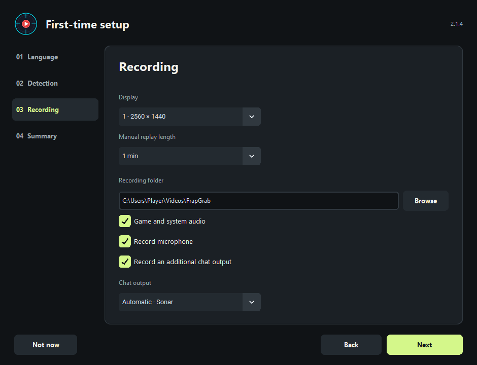

# User guide

[Download for Windows](https://github.com/kkeisyr11/FrapGrab/releases/latest/download/Frap_Grab_Setup_2.4.2.exe) · [Releases](https://github.com/kkeisyr11/FrapGrab/releases) · [Home](README.md)

Windows 10/11, 64-bit. The installer includes the required media tools.

Download the latest **Frap_Grab_Setup_*.exe** from Releases, run it and follow the installer.
Launch Frap Grab from the Start menu or desktop shortcut.
Choose the game in the top bar and click **Enable recording**. With the default
settings, the status changes to **Waiting for game** until the game is active.

Choose **English** in Settings. The interface switches immediately.

The first-run wizard configures language, game, detection, recording and audio.
War Dogs is available in the current installer. Its automatic detection and
recording analysis require your in-game name. Manual F8 capture and voice reactions
work without it. New profiles start with an empty player name and HUD template.

To try the Rocket League beta, choose **Rocket League** and enter your scoreboard
name. On the **Rocket League** page, select **Enable match data** while the game
is closed. The folder picker opens at the installation if Steam or Epic can
locate it. The app enables the local
[Stats API](https://www.rocketleague.com/developer/stats-api) and keeps a backup of
the INI file. Restart the game and select the goals, assists, and saves you want.

On the **War Dogs** page, pick the events that trigger automatic clips.
Deaths and knockdowns use OCR. You can save all assists or limit them to
8 or 15 seconds on either side of your own kill.
The wizard can be reopened from Settings. Updates keep existing user preferences.
Personal settings and templates are stored outside the installer.

## Navigation

The Dashboard contains replay length, the buffer, the replay shortcut and
recording status. Picking a game opens its named sidebar page. Game settings
and recording analysis are on that page. Recording analysis is available
for War Dogs.

[See released and experimental game integrations](docs/game-coverage.md).

GPU settings are automatic by default. Family presets cover GeForce RTX 20/30/40/50,
GTX 10/16, Radeon RX 5000/6000/7000/9000 and Intel Arc. A short encode/decode test
checks the actual driver before an encoder is offered. RTX 30 does not get AV1
recording; unsupported codecs are rejected. The fallback is a clearly labelled
30 FPS CPU profile. Advanced users can disable automatic settings.

War Dogs live detection uses pixel matching. For initial HUD calibration, enter your player
name and save a replay containing your kill with F8. After leaving the game, the
app can locate your nickname and create a template automatically using offline OCR.
Calibration pauses while the game is active. You can also select **Detect HUD from
a replay**. HUD geometry scales with display height and supports ultrawide layouts.
Custom HUD/font changes may require detecting the HUD again. Manual coordinates
and calibration remain under Advanced.

Choose the manual replay length beside **Save replay**, up to 30 minutes. Increasing
the length grows the disk buffer from that point onwards. Earlier deleted footage
cannot be recovered. Recordings are stored by date.

In Editor, choose kills, assists and voice reactions independently. Assists may be
restricted to within 8 or 15 seconds of a kill. Overlapping replays are aligned and
merged. Estimate the duration before export; the actual duration appears afterwards.
Music can be added before export or to a finished video, preserving video packets.

In the [2.5.0 preview](https://github.com/kkeisyr11/FrapGrab/releases/tag/v2.5.0),
**Suggest an AI edit** in Editor creates an optional plan for selected clips.
Pick a preset for a YouTube highlight reel, a vertical Short, or microphone
reactions. You can change the prompt, duration and format before generating.
ChatGPT connects through the official browser sign-in and uses an eligible
ChatGPT plan. Claude opens in the browser with a brief copied to the clipboard.
Paste its JSON reply in the editor to review the suggested order and cuts.
Both modes share the prompt, clip durations and recorded event markers. The
video, audio and original file paths stay local, and Frap Grab renders the
approved plan on your PC. Choose **Export this plan** to open the MP4 save dialog,
or use the plan in Editor and add music first.

Voice reactions are triggered by your default Windows microphone only. Discord
and game audio can be recorded, but never trigger voice clips. Turning off
**Record my microphone** only removes your voice from the video; microphone
reactions and automatic kill/assist clips still work. The editor uses microphone
tracks and saved reaction markers, rather than scanning Discord or game audio.

If chat uses another playback device, enable **Record an additional chat output**
and select it under **Chat output** in Settings or first-run setup. This works
with ordinary WASAPI outputs, including USB headsets and virtual audio devices.
**Automatic · Sonar** keeps the previous automatic Sonar Chat setup. When system
audio already records the selected output, it is not added a second time.
Discord on the main output is included in system audio without an extra source.

Recording analysis uses the calibrated HUD detector when the selected player
matches the profile. Without that profile, it scans sequentially with OCR and
GPU decoding where available. OCR results should be reviewed. The bundled assist
template currently recognizes the Polish War Dogs HUD.

Automatic events require an active buffer. Incomplete replays are reported,
including markers that fall outside the saved footage. Original files are kept.

Updates use kkeisyr11/FrapGrab on GitHub Releases. Frap Grab checks
at startup and shows the changelog in the interface language when available.
Checks can be disabled in Settings. Installation requires your click, a matching
installer, and verified SHA-256.
See `RELEASE.md` for publication details.

Validated locally: RTX 5080 capture and NVIDIA editing, plus HEVC AMF recording
and D3D11VA/AMF editing on the integrated Radeon. Presets for RX 7900 XTX, RX 9070 XT
and RX 9060 XT are not a claim of physical gaming-performance tests on those cards.

See [THIRD_PARTY_NOTICES.md](THIRD_PARTY_NOTICES.md) for dependency notices.
