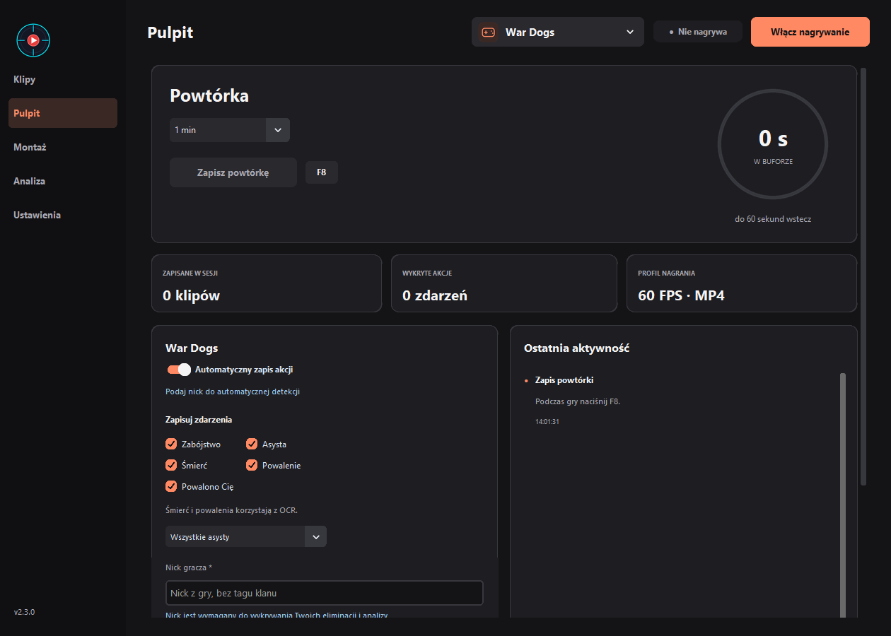

# Frap Grab

A Windows game recorder and highlight editor.
Save instant replays, automatic kill/assist clips and voice highlights.

[Download installer (.exe)](https://github.com/kkeisyr11/FrapGrab/releases/latest/download/Frap_Grab_Setup_2.5.1.exe) · [Guide](README.en.md)

- Replay buffer with F8 saves, from 10 seconds to 30 minutes.
- Automatic clips from kills, assists and voice reactions.
- Clips grouped by day, highlight editing and background music.
- AI editing plans with presets for YouTube, Shorts and microphone reactions.
- GPU recording on NVIDIA, AMD and Intel, with automatic encoder checks.

## Automatic clipping in the Windows installer

- **War Dogs** — automatic clips for kills, assists, deaths and knockdowns, with replay analysis.
- **Rocket League** (beta) — goals, assists, and saves through the official Stats API.

[Integration status for games listed by Moments and Medal](docs/game-coverage.md).

English and Polish interface. Windows 10/11 x64. Download the installer and follow the setup steps.

For War Dogs, record a replay containing your own kill to calibrate HUD detection.
Frap Grab records the selected display and saves clips locally.

[Third-party licenses](THIRD_PARTY_NOTICES.md)
